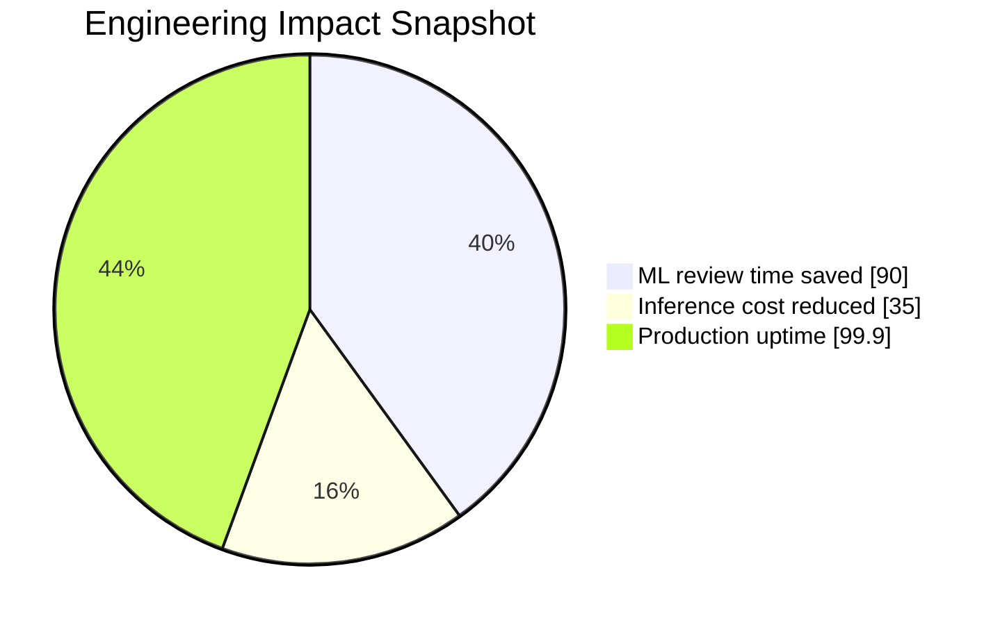
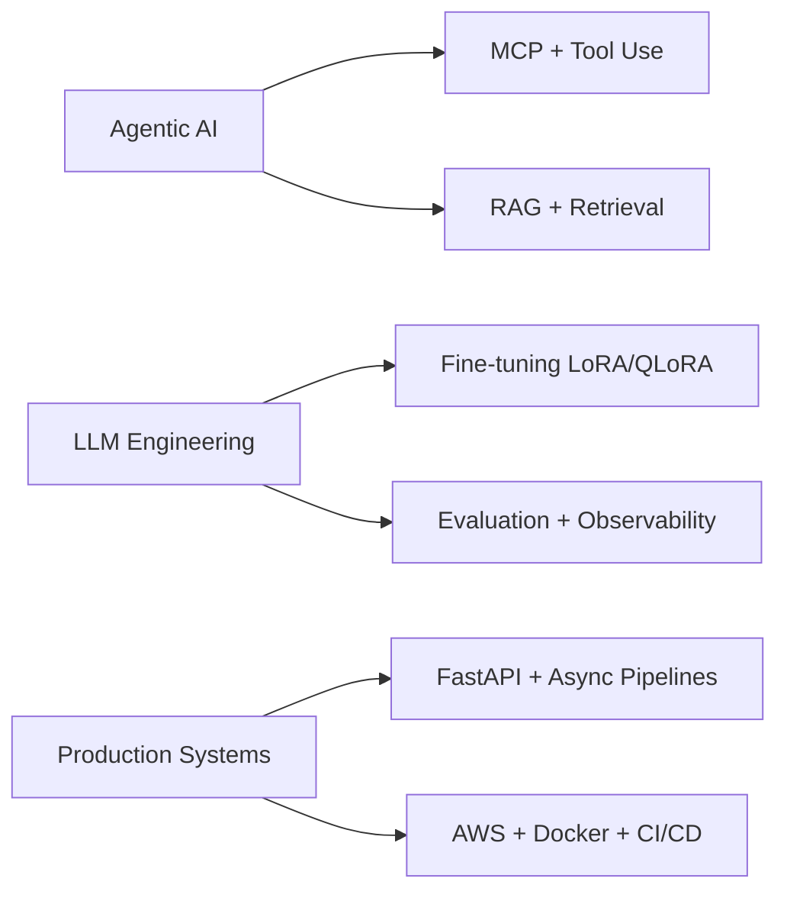

<h1 align="center">Akash Kore</h1>

<b>AI Software Engineer • Agentic AI • Production ML Systems</b>

  Building practical LLM products with measurable impact.

  
  
  

  
  
  

## Impact at a glance

  
  
  
  

## Core capabilities
**Agentic AI & LLM Systems**  
`MCP` `LangGraph` `LangChain` `RAG` `GPT-4o` `Claude` `LoRA/QLoRA` `vLLM`

**Backend & MLOps**  
`Python` `FastAPI` `PostgreSQL` `Redis` `Docker` `AWS` `GitHub Actions`

## Featured projects
### [B.I.A.S.E.D.](https://github.com/theSelfSa/biased)
Open-source AI decision intelligence platform for SMBs with MCP server + LangGraph orchestration.  
`FastAPI` `Next.js` `MCP` `LangGraph` `pgvector` `Ollama`

### [Receipt Intelligence Pipeline](https://github.com/theSelfSa/receipt-intelligence-pipeline)
Production-grade OCR + LLM pipeline with confidence routing and human-in-the-loop learning.  
`FastAPI` `Celery` `Redis` `PostgreSQL` `OCR` `Docker`

### [ReadyTensor](https://github.com/theSelfSa/ReadyTensor)
Lightweight repository assessment/evaluation tool for AI/ML workflows.  
`Python` `LLM Evaluation` `Developer Tooling`

### [Akash Portfolio](https://github.com/theSelfSa/akash-portfolio)
Personal portfolio focused on performance, storytelling, and recruiter-friendly project presentation.  
`React` `TypeScript` `Vite` `Tailwind`

## Currently focused on
- Agentic AI systems that connect tool use + retrieval + evaluation in production.
- Faster, lower-cost inference architecture for practical AI products.
- Building open-source projects that solve real operational problems.
